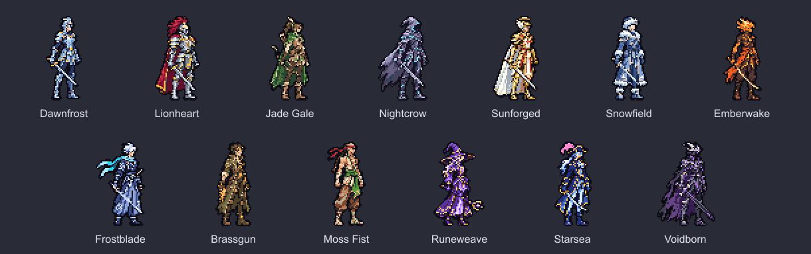

# 牌刃疾行 · 角色资产

[13 个角色站姿完整包](packages/deckblade-standing-A.zip) · [晨霜三视图与动作完整包](packages/deckblade-dawnfrost-BC.zip)

- `standing/`：13 张透明站姿 PNG，单帧 96×80，角色轮廓高 64 像素。
- `dawnfrost/`：三视图按朝右、正面、背面排列；六组动作均为单行图条，按 96×80 切帧。待机 4、跑步 8、斩击 6、施法 4、受击 2、跳跃 4，共 28 帧。
- 原生帧共用脚底基线 y=71；播放时长见晨霜目录的 manifest.json。跳跃位移由游戏控制。
- 两个 ZIP 保留生成原稿和八倍图。此提交仅添加资产，不改变游戏代码。
